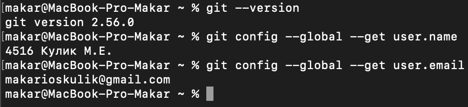
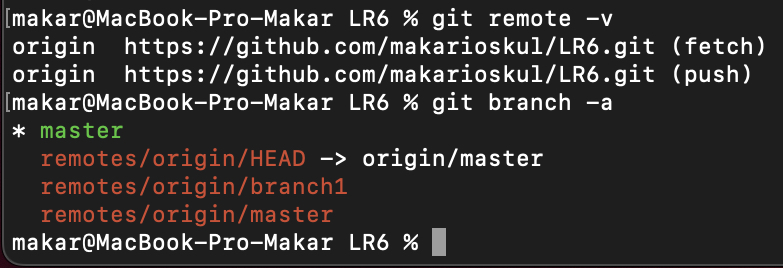
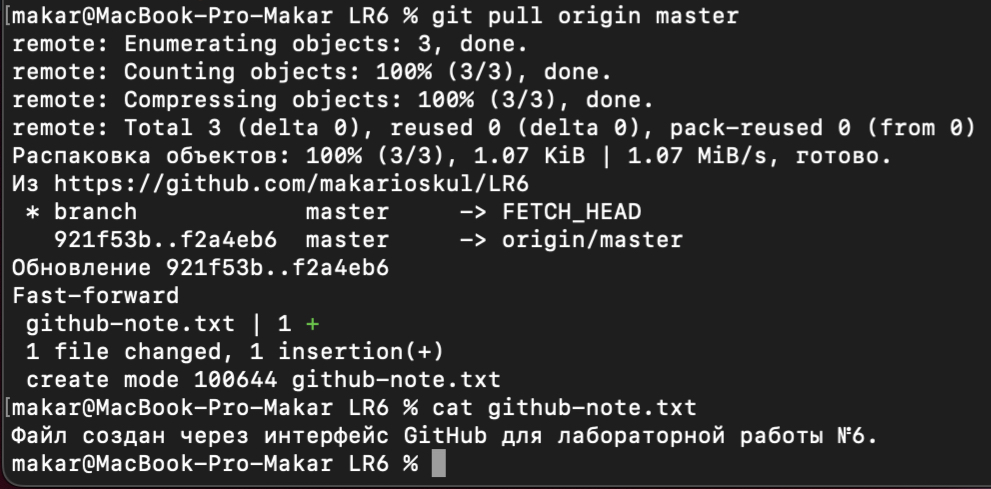
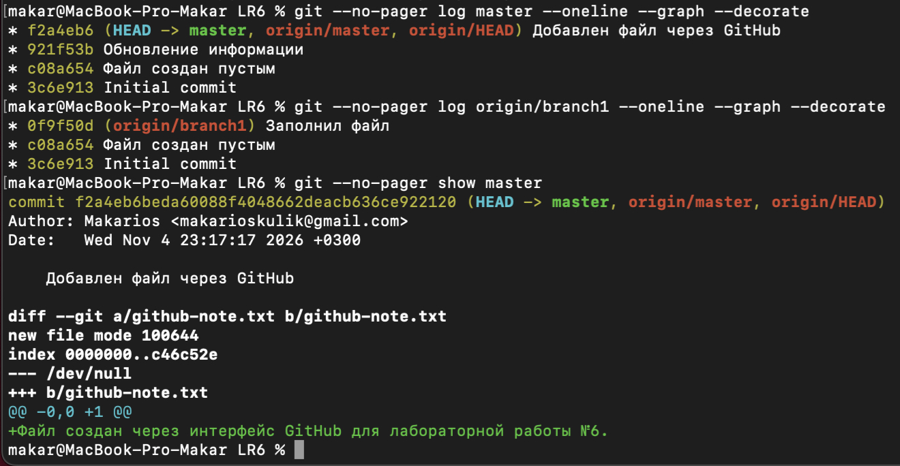
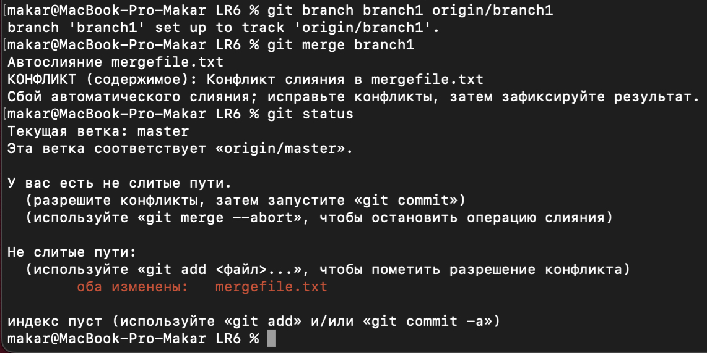
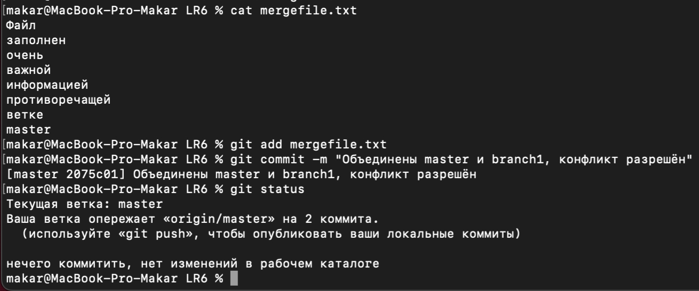
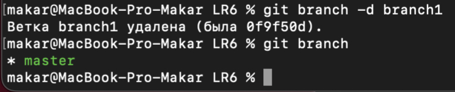
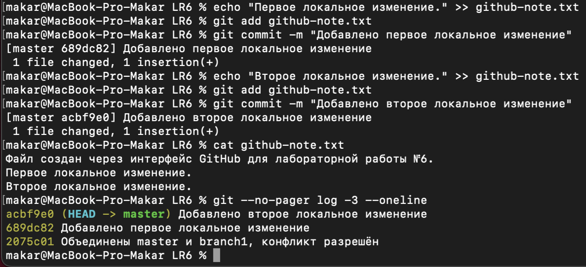
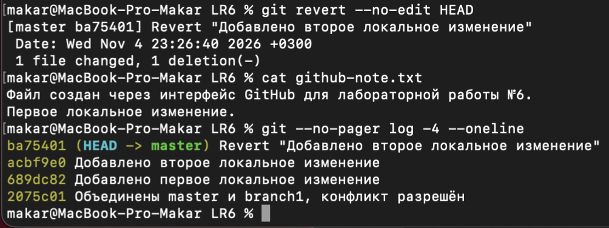
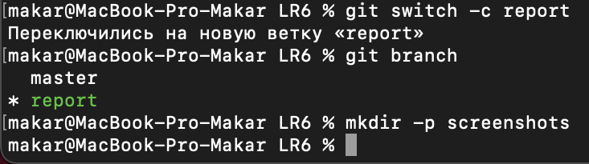

# Лабораторная работа №6
## Система контроля версий Git

**Выполнил:** Кулик М.Е.
**Группа:** 4516

## Цель работы

Изучить базовые возможности Git и получить опыт работы
с локальным и удалённым репозиториями.

## Ход работы

1. Создан аккаунт GitHub и выполнен Fork репозитория Kurtyanik/LR6.
2. Установлен Git, настроены имя автора и электронная почта.
3. Личный репозиторий клонирован на компьютер.
4. Через GitHub добавлен файл github-note.txt.
   Изменения получены локально командой git pull.
5. Просмотрены история веток master и branch1 и последний коммит.
6. Выполнено слияние branch1 в master.
   Конфликт в mergefile.txt разрешён вручную с объединением текста.
7. После слияния удалена локальная ветка branch1.
8. Созданы два коммита с изменениями github-note.txt.
9. Последнее изменение отменено командой git revert.
   История коммитов сохранена.
10. Создана отдельная ветка report для оформления отчёта.

## Скриншоты выполнения

### Настройка Git


### Клонирование репозитория


### Получение изменений с GitHub


### История веток и последние изменения


### Конфликт при слиянии


### Разрешение конфликта


### Удаление побочной ветки


### Создание коммитов


### Откат последнего изменения


### Создание ветки отчёта


## Лог команд

```bash
git --version
git config --global user.name "4516 Кулик М.Е."
git config --global user.email "makarioskulik@gmail.com"
git config --global --get user.name
git config --global --get user.email
cd ~/Documents
git clone https://github.com/makarioskul/LR6.git
cd LR6
git remote -v
git branch -a
git pull origin master
cat github-note.txt
git --no-pager log master --oneline --graph --decorate
git --no-pager log origin/branch1 --oneline --graph --decorate
git --no-pager show master
git branch branch1 origin/branch1
git merge branch1
git status
cat mergefile.txt
nano mergefile.txt
cat mergefile.txt
git add mergefile.txt
git commit -m "Объединены master и branch1, конфликт разрешён"
git status
git branch -d branch1
git branch
echo "Первое локальное изменение." >> github-note.txt
git add github-note.txt
git commit -m "Добавлено первое локальное изменение"
echo "Второе локальное изменение." >> github-note.txt
git add github-note.txt
git commit -m "Добавлено второе локальное изменение"
cat github-note.txt
git --no-pager log -3 --oneline
git revert --no-edit HEAD
cat github-note.txt
git --no-pager log -4 --oneline
git switch -c report
git branch
mkdir -p screenshots
open .
nano README.md
git add README.md screenshots
git commit -m "Начато оформление отчёта, добавлены скриншоты"
ls screenshots
nano README.md
git add README.md
git commit -m "Добавлены скриншоты этапов работы в отчёт"
```
